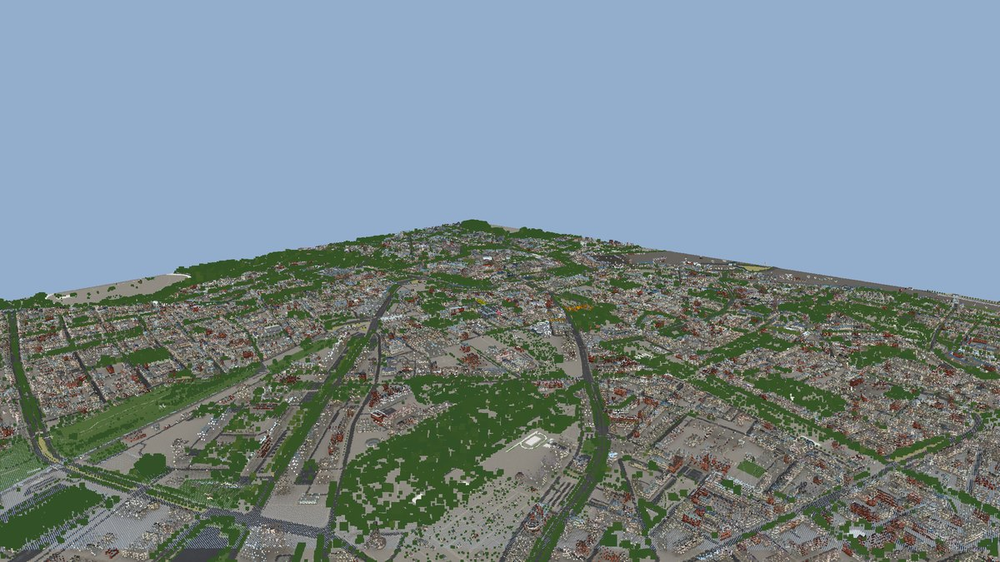

# Leipzig 3D

Ein realitätsgetreues, interaktives 3D-Modell der Leipziger Innenstadt im
Browser – gebaut aus echten Geodaten: **LoD2-Gebäudemodell** des Landes
Sachsen, **DGM1-Gelände**, **Baumkataster** der Stadt, Straßen-, Gewässer- und
Möblierungsdaten aus **Basis-DLM und OpenStreetMap**.

* **4 × 4 km** Innenstadt im amtlichen Koordinatensystem (EPSG:25833)
* **11 437 Gebäude** mit echter Dachform, Traufhöhe, Nutzung und Dachfarbe aus
  dem Orthophoto
* **53 385 Bäume** (Baumkataster + Kronenpunkte aus dem Oberflächenmodell)
* **~150 000** Objekte Stadtmöblierung: Mauern, Hecken, Brücken, Denkmäler,
  Laternen, Bänke, Gleise, Bahnsteige
* Sonnenstand nach Datum und Uhrzeit für Leipzig, Schattenwurf,
  Nachtbeleuchtung, prozedurale Fassaden mit Fenstern
* Klick auf jedes Gebäude: Steckbrief (Höhe, Geschosse, Grundfläche, Nutzung,
  Denkmalschutz)



## Starten

```bash
npm install
npm run dev        # http://localhost:5173
```

Die Modelldaten liegen fertig gebacken in `public/data` (rund 16 MB) und
werden beim Öffnen geladen; die Seite braucht nur einen Webserver, kein
Backend.

Für einen statischen Aufbau:

```bash
npm run build      # erzeugt dist/ (index.html + data/)
npm run preview
```

## Bedienung

| Aktion | Wirkung |
|---|---|
| Ziehen mit linker Maustaste | um das Ziel drehen |
| Ziehen mit rechter Maustaste / Umschalt+Ziehen | verschieben |
| Mausrad / Zwei-Finger-Geste | zoomen |
| W A S D, Pfeiltasten | verschieben |
| Q / E | drehen, R / F | zoomen |
| Klick auf ein Gebäude | Steckbrief und Hervorhebung |
| Leertaste | nächste Station des Rundflugs |
| Minimap anklicken | dorthin springen |
| Tageszeit-Regler | 3:00 bis 23:00 Uhr, Schatten wandern mit |

## Daten neu backen

Die Rohdaten sind nicht im Git (91 MB). Sie lassen sich reproduzierbar holen:

```bash
python3 pipeline/fetch_raw.py    # data/raw/leipzig (LoD2, DGM1, DLM, DOP, Bäume)
python3 -m pip install numpy pillow shapely rasterio mapbox_earcut
npm run bake                     # public/data/*
npm test                         # Prüfungen
```

Details zu Quellen, Lizenzen und Bezugswegen: [`docs/DATENQUELLEN.md`](docs/DATENQUELLEN.md).
Aufbau der Binärformate, Shader und Tests: [`docs/MODELL.md`](docs/MODELL.md).
Kontrollbilder (Plangrundriss, Software-Renderings): `docs/plan.jpg`,
`docs/ansicht-*.jpg`.

## Projektstruktur

```
index.html            Oberfläche (Bedienfeld, Steckbrief, Minimap, Rundflug)
styles.css            Gestaltung
src/                  Betrachter
  loader.js           Laden und Auspacken der Modelldaten, Höhen-/Wasserabfrage
  decode.js           Binärformate -> Typfelder
  world.js            Szene: Gelände, Gebäude, Bäume, Wasser, Requisiten,
                      Materialien/Shader, Schattendurchgang
  env.js              Sonnenstand für Leipzig, Lichtstimmung, Himmel
  app.js              Steuerung, Suche, Rundflug, Minimap, Gebäude-Steckbrief
public/data/          gebackene Modelldaten (im Git)
pipeline/             Python-Bake (Rohdaten -> public/data)
  tests/              Node-Prüfungen (Formate, Shader, Ladepfad)
  tools/              Software-Renderer für Sichtkontrollen ohne Browser
docs/                 Datenquellen, Technik, Kontrollbilder
```

## Herkunft und Rechte

Daten: © GeoSN – Landesamt für Geobasisinformation Sachsen (dl-de/by-2-0) ·
© OpenStreetMap-Mitwirkende (ODbL) · Stadt Leipzig, Amt für Stadtgrün und
Gewässer (dl-de/by-2-0) · Mapillary (CC BY-SA 4.0) · Fahrplandaten DELFI/gtfs.de
(CC BY 4.0). Die Rohdaten-Aufbereitung stammt aus dem offenen Projekt
[mdugue/bridge](https://github.com/mdugue/bridge) (Apache-2.0), das die
sächsischen Produkte unter dl-de/by-2-0 weiterverwendet.

Der Betrachter-Code dieses Repos steht unter der MIT-Lizenz (siehe `LICENSE`),
die Modelldaten unter den oben genannten Quelllizenzen.
